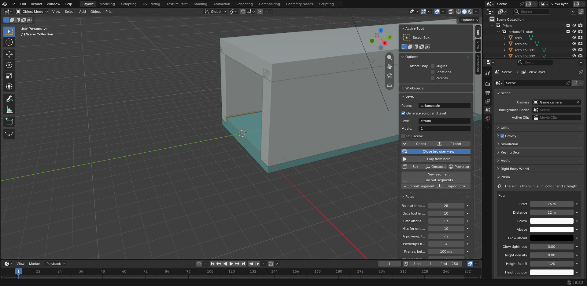
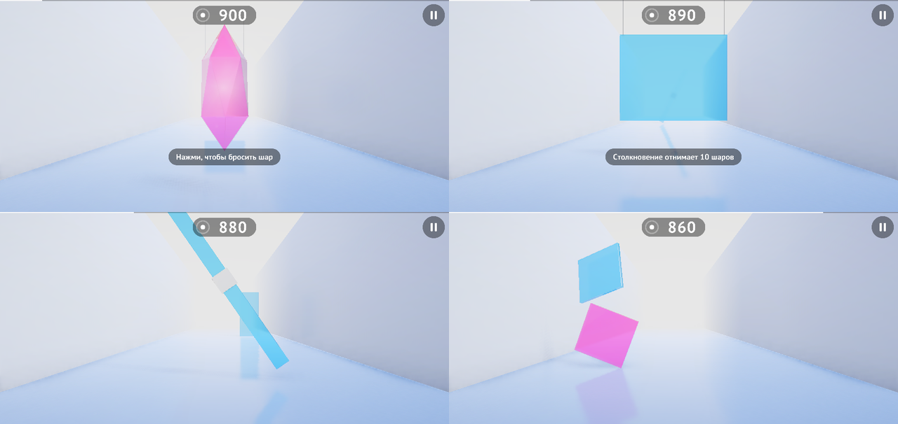

# Prism Tools

A Blender add-on for building levels of the game Prism. The game runs beside Blender in a browser: move an object in
Blender and it moves in the game. Windows, macOS and Linux; nothing but Blender and a browser is needed.

**[Download the add-on](https://github.com/voronoff2803/prism-tools/releases/latest/download/prism_tools.zip)** ·
[По-русски](README.ru.md) · [Scripting reference](docs/Scripting.md)

## Installing

1. Blender 4.2 or later, and a browser with WebGPU: Chrome or Edge (113+), Firefox (141+), Safari (26+).
2. Download [`prism_tools.zip`](https://github.com/voronoff2803/prism-tools/releases/latest/download/prism_tools.zip).
   Do not unpack it.
3. In Blender: `Edit → Preferences → Get Extensions`, the arrow at the top right → `Install from Disk`, choose the file.
   Dropping the file onto Blender's window works too.
4. Save the `.blend` somewhere. Press `N` in the 3D viewport and open the **Prism** tab.

To update, download the new file and install it over the old one.

## A first level in five minutes

1. **Start a room**: a first piece of corridor with a floor, walls, a sun and the game's camera. The cube, lamp and
   camera Blender opens a new file with are removed.
2. **Browser** (or `Shift Alt E`): the game opens in the browser. The first time it is fetched, about 110 MB; after that
   it opens at once and needs no network.
3. Put the windows side by side. The browser's camera follows Blender's viewport, and edits arrive by themselves.
4. **Play from here** plays the level from where the viewport is. **Back to the viewport** returns to editing.

## What a level is made of

| What | How |
|---|---|
| A box | `Shift Alt D`. Floors, walls, steps: drawn and collided with. Size by scale, look by material. |
| An obstacle | `Shift Alt F`. Its type is chosen from the game's list (start typing), and the parameters its script reads are filled in: change them in Object → Prism. |
| A powerup | `Shift Alt C`. |
| Any geometry | An ordinary Blender mesh. In Object → Prism: **Kind: Visual**. **Physics**: None is drawn only; Static stands and collides; Body is a body of its own that balls push; Held stands until broken (glass in a wall). |
| Materials | Principled BSDF: colour, roughness, metal, emission. The material's Prism panel has glass (frost, relief, depth), coat, velvet, wax, colour and normal maps. |
| Light | One sun; point lamps, tubes (neon) and spots inside a segment. Fog, environment and reflections are in Scene → Prism. |
| A piece of corridor | A segment is a collection with **Segment** ticked (the Collection tab) and a length. **New segment** adds the next one, **Lay out segments** puts them end to end. |
| The game's own | **Import segment** and **Import look**: any segment and any room's look of the game's levels, by name, to build on. |

The **Prism** menu in the viewport's header has the same things.

## Free forms and glass

- **Any shape.** `Shift A` → any Blender mesh: after **Start a room** and **New segment** it goes into the segment's
  collection and shows in the game at once. A mesh outside a segment's collection is not in the game: **Check** says so.
- **Collision.** A mesh is only drawn by default (Physics: None). **Static** collides as its bounding box. For more
  than that add boxes that are not drawn: the **Prism** menu → Collider.
- **Glass.** The material: its Prism panel → **Glass**. Whatever is to break, move or give balls is an obstacle: the
  next section.

## Obstacles of your own, without code

An obstacle is built of ordinary meshes in the scene; the add-on writes its script for the game. An example of every
kind is [`examples/obstacles.blend`](examples/obstacles.blend): open it and press **Browser**.

1. Model the parts: glass is a material with **Glass** ticked, anything else is steel of the material's colour in the game.
2. Select them and choose **Prism** → **Obstacle from selection**. An Empty appears: it is the obstacle, and it moves,
   turns and is copied with its parts.
3. Select a part and give it a **Motion** (Object → Prism, or the Prism tab → Object in the sidebar):

   | Motion | What the part does |
   |---|---|
   | Fixed | Stands where it is. Glass breaks and its pieces fall. |
   | Free | A body of its own: it falls, and hangs on its joints and ropes. |
   | Animated | Follows Blender's keyframes (`I`: location and rotation). Repeat: loop, there and back, or once; it can wait for the camera to come within a distance. |
   | Spin | Turns about its own X, Y or Z axis at a given speed. |
   | Launch | Waits for the camera, then is let go with a push: a speed and a spin. A push of 0 just drops it. |

4. **Joints.** Select a part, put the 3D cursor where it is held, **Prism** → **Pin**, **Hinge**, **Slider** or **Rope**.
   The joint holds the part to the room; with one more part selected, to that part.

   | Joint | What it holds |
   |---|---|
   | Pin | A point of the part: the part swings about it freely. |
   | Hinge | An axis (the Empty's arrow): the part turns about it only. A door, a pendulum. |
   | Slider | A direction (the arrow): the part slides along it only. |
   | Rope | A rope from the point along the arrow to the first wall, floor or ceiling, or of a given length. |

5. **Balls.** The obstacle's Empty has **Gives balls**: what the player gets for breaking all of its glass.

Good to know:

- A part parented to another part (`Ctrl P`) is one body with it: glass in a steel frame, blades on a hub.
- A shape in the game is always convex. Every loose piece of a mesh is a convex shape of its own, so build what is not
  convex of several pieces in one mesh, or of several meshes.
- What cannot be built this way is written as a Lua script (see Gameplay); the script the add-on wrote is in
  `Content/obstacles/` after **Export**, and is a start for one.

## Gameplay

- **Rules**: the **Rules** panel below Level. Balls at the start, what a crash costs, how long a powerup lasts, the ball's
  speed and more. They change on the fly with the level.
- **Speed.** A room lasts one loop of its music, 32 seconds. A longer room means a faster camera.
- **Obstacles of your own** are Lua scripts. Put a file in `Content/obstacles/` beside the `.blend` (say `mine.lua`) and
  place it with `Shift Alt F`. While the scene is open in the browser the script is read again whenever it is saved, and
  its errors show in the Prism panel. What a script may call is in the [reference](docs/Scripting.md); the game's own
  scripts are the examples.

## Checking and handing over

- **Check** shows what would go wrong in the game (the Problems panel). A level with errors is not exported.
- **Export** (`Shift Alt R`) writes the level into a `Content` folder beside the `.blend`. Hand over that folder, or the
  `.blend`.
- `F12` with the Prism render engine: a frame of the game as a picture (the scene must be open in the browser).
- The `Content` folder opens without Blender too: **Your levels…** in the menu of the game's page.

## Coming from Shatter

| In Shatter | Here |
|---|---|
| Create box · `Shift Alt D` | The same keys. A Blender material in place of a template and a tile. |
| Create obstacle · `Shift Alt F` | The same keys; the parameters come from the script. |
| Create powerup · `Shift Alt C` | The same keys. |
| Quick Test on a phone · `Shift Alt E` | The same keys open the game in a browser on this computer: no phone, no APK. |
| Segment properties in Scene | A segment's length is its collection's; room, level and music are in the Level panel. |
| Boxes only | Any meshes, lights, materials, rules and scripts. |

## When something does not work

- The page says WebGPU is missing: update the browser and the graphics driver.
- An object is in Blender and not in the game: it lies outside a segment's collection (**Check** says so). Move it into
  the segment's collection.
- **Browser** or **Export** refuses: the message names the scene's first error, the rest are in the **Problems** panel.
- A red line in the Prism panel says what the game waits for: no page open, the scene did not start, or the game was not
  fetched.
- The game is not fetched: the address or the folder of the game's build is in the add-on's preferences
  (`Edit → Preferences → Add-ons → Prism Tools`), **Web build**.
- The panel says the game is older than the add-on: the build at the **Web build** address has no live view; a newer one
  is needed.

Decals and water are not supported yet.

## What is here

- [`prism_tools/`](prism_tools): the add-on's sources; the file to install is made from them and is in
  [Releases](https://github.com/voronoff2803/prism-tools/releases).
- [`docs/Scripting.md`](docs/Scripting.md): what a room's or an obstacle's script may call.
- [`examples/obstacles.blend`](examples/obstacles.blend): a corridor of obstacles built in Blender, one of each kind.

The add-on is licensed GPL-3.0-or-later ([LICENSE](LICENSE)). The game itself is not in this repository: the add-on takes
its build from the address in its preferences.
