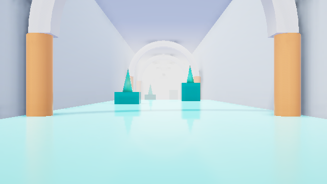

# Prism Tools

Аддон для Blender, в котором собираются уровни игры Prism. Игра идёт рядом в браузере: двигаете объект в Blender — он сразу
двигается в игре. Работает на Windows, macOS и Linux; кроме Blender и браузера ничего не нужно.

**[Скачать аддон](https://github.com/voronoff2803/prism-tools/releases/latest/download/prism_tools.zip)** ·
[English](README.en.md) · [Справочник по скриптам](docs/Scripting.md)

## Установка

1. Нужны Blender 4.2 или новее и браузер с WebGPU: Chrome или Edge (113+), Firefox (141+), Safari (26+).
2. Скачайте [`prism_tools.zip`](https://github.com/voronoff2803/prism-tools/releases/latest/download/prism_tools.zip).
   Распаковывать его не надо.
3. В Blender: `Edit → Preferences → Get Extensions`, стрелка справа вверху → `Install from Disk`, выберите скачанный файл.
   Можно и просто перетащить файл в окно Blender.
4. Сохраните `.blend` в любую папку. В окне 3D нажмите `N` и откройте вкладку **Prism**.

Обновление — так же: скачать новый файл и установить поверх.

## Первый уровень за пять минут

1. **Start a room** — появится первый кусок коридора: пол, стены, солнце и камера игры.
2. **Browser** (или `Shift Alt E`) — игра откроется в браузере. В первый раз она скачивается, около 110 МБ; дальше
   открывается сразу и работает без сети.
3. Поставьте окна рядом. Камера в браузере идёт за видом в Blender, любая правка приходит сама.
4. **Play from here** — уровень играется с того места, где сейчас вид. **Back to the viewport** возвращает к правке.

## Из чего собирается уровень

| Что | Как |
|---|---|
| Коробка | `Shift Alt D`. Пол, стены, ступени: рисуется и сталкивается. Размер — масштабом, вид — материалом. |
| Препятствие | `Shift Alt F`. Тип выбирается из списка игры (начните печатать), параметры его скрипта подставляются сами — меняйте их во вкладке Object → Prism. |
| Бонус | `Shift Alt C`. |
| Любая геометрия | Обычный меш Blender. Во вкладке Object → Prism: **Kind: Visual**. **Physics**: None — только рисуется; Static — стоит и сталкивается; Body — отдельное тело, шары его толкают; Held — стоит, пока не разобьют (стекло в стене). |
| Материалы | Principled BSDF: цвет, шероховатость, металл, свечение. В панели Prism материала — стекло (матовость, рельеф, толща), лак, бархат, воск, карты цвета и нормалей. |
| Свет | Одно солнце; точечные лампы, трубки (неон) и прожекторы внутри сегмента. Туман, окружение, отражения — вкладка Scene → Prism. |
| Кусок коридора | Сегмент — это коллекция с галочкой **Segment** (вкладка Collection) и длиной. **New segment** добавляет следующий, **Lay out segments** ставит их встык. |
| Готовое из игры | **Import segment** и **Import look**: любой сегмент и любой вид комнаты из уровней игры, по имени — как основа для своего. |

Всё то же есть в меню **Prism** в шапке окна 3D.

## Геймплей

- **Правила** — панель **Rules** под Level: шары на старте, цена столкновения, длительность бонусов, скорость шара и
  другое. Меняются на лету вместе с уровнем.
- **Скорость.** Комната длится один круг музыки, 32 секунды. Длиннее комната — быстрее камера.
- **Свои препятствия** — это скрипты на Lua. Положите файл в папку `Content/obstacles/` рядом с `.blend` (например
  `mine.lua`) и поставьте его через `Shift Alt F`. Пока сцена открыта в браузере, скрипт перечитывается при каждом
  сохранении, а его ошибки видны в панели Prism. Что скрипт может вызывать — в [справочнике](docs/Scripting.md); скрипты
  самой игры служат примерами.

## Проверка и сдача

- **Check** показывает, что пойдёт не так в игре (панель Problems). С ошибками уровень не выгружается.
- **Export** (`Shift Alt R`) пишет уровень в папку `Content` рядом с `.blend`. Сдавать — эту папку или сам `.blend`.
- `F12` с движком рендера Prism — кадр из игры как картинка (сцена должна быть открыта в браузере).
- Папку `Content` можно открыть и без Blender: в меню игры на её странице — «Свои уровни…».

## Если вы привыкли к Shatter

| В Shatter | Здесь |
|---|---|
| Create box · `Shift Alt D` | То же сочетание. Вместо шаблона и тайла — материал Blender. |
| Create obstacle · `Shift Alt F` | То же сочетание; параметры подставляются из скрипта. |
| Create powerup · `Shift Alt C` | То же сочетание. |
| Quick Test на телефоне · `Shift Alt E` | То же сочетание открывает игру в браузере на этом же компьютере; телефон и APK не нужны. |
| Segment properties в Scene | Длина сегмента — у его коллекции; комната, уровень и музыка — панель Level. |
| Только коробки | Любые меши, свет, материалы, правила и скрипты. |

## Если что-то не работает

- Страница пишет, что не хватает WebGPU — обновите браузер и драйвер видеокарты.
- В панели Prism красная строка — там написано, чего ждёт игра: нет открытой страницы, сцена не запустилась или игра не
  скачалась.
- Игра не скачивается — адрес или папка со сборкой игры задаются в настройках аддона
  (`Edit → Preferences → Add-ons → Prism Tools`), поле **Web build**.
- Панель пишет, что игра старее аддона, — по адресу из **Web build** лежит сборка без живого просмотра; нужна новая.

Декали и вода пока не поддерживаются.

## Что внутри

- [`prism_tools/`](prism_tools) — исходники аддона; установочный файл собирается из них и лежит в
  [Releases](https://github.com/voronoff2803/prism-tools/releases).
- [`docs/Scripting.md`](docs/Scripting.md) — что может вызывать скрипт комнаты и препятствия.

Аддон распространяется по лицензии GPL-3.0-or-later ([LICENSE](LICENSE)). Сама игра в этот репозиторий не входит: аддон
берёт её сборку по адресу из своих настроек.
